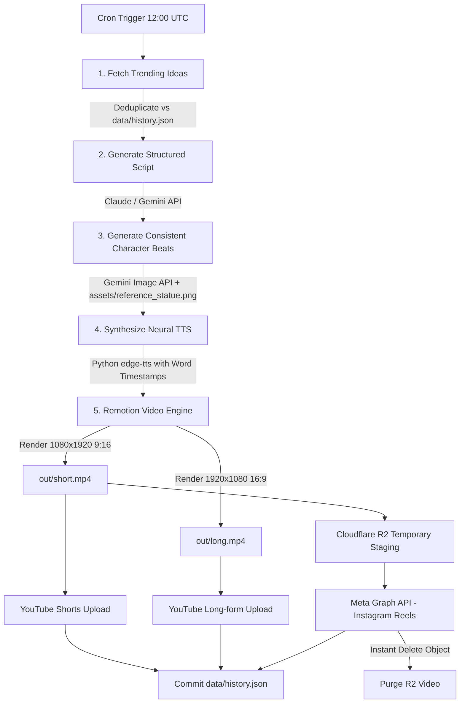

# Automated Matte-Black Mannequin Content Pipeline 🎬

[](https://github.com/your-username/matte-black-content-pipeline/actions/workflows/daily-pipeline.yml)
[](https://www.remotion.dev/)
[](#zero-cost-architecture)

An end-to-end autonomous media generation engine hosted on a **public GitHub repository**. The pipeline runs on a daily cron schedule to discover viral concepts, generate structured scripts, render consistent character imagery, synthesize neural speech, programmatically render high-retention motion graphics via Remotion, and syndicate to **YouTube** and **Instagram Reels**.

---

## 🏛️ Visual Aesthetic & Consistency Rules

| Element | Specification | Rationale |
| :--- | :--- | :--- |
| **Hero Subject** | Matte-black mannequin statue with smooth, featureless blank oval face | Timeless, authoritative, minimalist identity without uncanny facial artifacts. |
| **Canvas** | Pure Solid White (`#FFFFFF`) | High contrast luxury aesthetic inspired by Apple, editorial print, and brutalist web design. |
| **Layer Blending** | CSS `mix-blend-mode: multiply` | Eliminates any off-white bounding artifacts from generated PNGs seamlessly without green screens or edge-matting. |
| **Motion Graphics** | Kinetic typography, spring floating callouts, progress tracks, frame-synced captions | Keeps audience engagement peak high on 9:16 vertical and 16:9 widescreen formats. |

---

## ⚙️ Architecture & Pipeline Flow



---

## 💰 Zero-Cost Infrastructure Breakdown

1. **Compute:** GitHub Actions on public repositories provides **unlimited free compute minutes** for automation.
2. **Speech Synthesis (TTS):** Microsoft neural voices via Python `edge-tts` (free, ultra-natural, includes frame-accurate word boundary timestamps).
3. **Video Rendering:** Remotion running in headless Chromium with hardware acceleration on Ubuntu runners.
4. **Temporary Staging:** Cloudflare R2 S3 API (free tier includes 10GB storage and zero egress fees; files are purged within 2 minutes of publishing).
5. **Distribution APIs:** YouTube Data API v3 and Meta Graph API (free developer tiers).

---

## 📁 Repository Layout

```text
├── .github/
│   └── workflows/
│       └── daily-pipeline.yml      # Cron trigger, setup Node/Python/FFmpeg, run pipeline
├── assets/
│   └── reference_statue.png        # Master reference image of matte-black mannequin
├── data/
│   └── history.json                # Tracks published topics/IDs to prevent duplicates
├── scripts/
│   ├── 1_fetch_idea.ts             # Fetches RSS/Reddit topics, filters duplicates
│   ├── 2_generate_script.ts        # Calls LLM API to output strict JSON script + prompts
│   ├── 3_generate_images.ts        # Calls Gemini Image API with reference statue
│   ├── 4_generate_audio.py         # Runs edge-tts to produce voiceover.mp3 + word timestamps
│   ├── 5_publish.ts                # Uploads to YouTube (Long & Short) + R2 -> IG Reels
│   └── run_pipeline.ts             # Master CLI orchestrator executing steps 1–5 + render
├── remotion/
│   ├── Root.tsx                    # Registers ShortVideo (9:16) and LongVideo (16:9)
│   ├── compositions/
│   │   ├── ShortVideo.tsx          # Vertical motion graphics template (1080x1920)
│   │   └── LongVideo.tsx           # Horizontal chapter-based template (1920x1080)
│   ├── components/
│   │   ├── StatueStage.tsx         # Mix-blend-mode: multiply + subtle camera motion
│   │   ├── KineticCaptions.tsx     # Word-by-word synced kinetic typography
│   │   └── InfoCard.tsx            # Floating neo-minimalist badges, stats, and bullets
│   └── types.ts                    # Shared TypeScript interfaces
├── package.json
├── tsconfig.json
└── remotion.config.ts
```

---

## 🚀 Quickstart & Local Testing

### 1. Prerequisites
- **Node.js:** v20.x or later
- **Python:** v3.10+ (for `edge-tts`)
- **FFmpeg:** Installed and available on system PATH

### 2. Installation
```bash
# Clone the repository
git clone https://github.com/your-username/matte-black-content-pipeline.git
cd matte-black-content-pipeline

# Install Node dependencies
npm install

# Install Python TTS dependencies
pip install edge-tts
```

### 3. Live Preview in Remotion Studio
Preview and interact with the motion graphic templates directly in your browser:
```bash
npm start
```
Open [http://localhost:3000](http://localhost:3000) to inspect both `ShortVideo` and `LongVideo`.

### 4. Running a Local Pipeline Dry-Run
Execute the entire pipeline locally without publishing:
```bash
npm run pipeline:dry
```

Or trigger a run with a custom topic:
```bash
npx tsx scripts/run_pipeline.ts --topic="The Physics of Quantum Supercomputing" --dry-run
```

---

## 🔐 GitHub Secrets Configuration

Add the following secrets to your GitHub repository under **Settings > Secrets and variables > Actions**:

| Secret Key | Description | How to Obtain |
| :--- | :--- | :--- |
| `GEMINI_API_KEY` | Google AI Studio Key | [Google AI Studio](https://aistudio.google.com/) |
| `ANTHROPIC_API_KEY` | *(Optional)* Claude API Key | [Anthropic Console](https://console.anthropic.com/) |
| `YOUTUBE_CLIENT_ID` | OAuth 2.0 Client ID | Google Cloud Console -> APIs & Services |
| `YOUTUBE_CLIENT_SECRET` | OAuth 2.0 Client Secret | Google Cloud Console -> APIs & Services |
| `YOUTUBE_REFRESH_TOKEN` | OAuth 2.0 Refresh Token | Google OAuth 2.0 Playground (YouTube v3 scope) |
| `INSTAGRAM_ACCOUNT_ID` | Instagram Professional ID | Meta Graph API Explorer (`GET /me/accounts`) |
| `INSTAGRAM_ACCESS_TOKEN` | Long-Lived User Access Token | Meta Developer App with `instagram_content_publish` |
| `CLOUDFLARE_R2_ACCOUNT_ID` | Cloudflare Account ID | Cloudflare Dashboard URL / R2 Overview |
| `CLOUDFLARE_R2_ACCESS_KEY_ID` | R2 S3 Token ID | Cloudflare Dashboard -> R2 -> Manage R2 API Tokens |
| `CLOUDFLARE_R2_SECRET_ACCESS_KEY`| R2 S3 Secret Key | Cloudflare Dashboard -> R2 -> Manage R2 API Tokens |
| `CLOUDFLARE_R2_BUCKET_NAME` | R2 Bucket Name | Cloudflare Dashboard -> R2 -> Buckets |
| `CLOUDFLARE_R2_PUBLIC_URL` | R2 Public Bucket Domain | Cloudflare Bucket Settings -> Public Development URL |

---

## 🔄 GitHub Actions Automation & Artifacts

- **Cron Schedule:** Fires daily at `12:00 UTC` (`0 12 * * *`).
- **Manual Trigger:** Supports `workflow_dispatch` with custom topic input and format choices.
- **Artifacts:** High-definition rendered MP4s (`out/short.mp4` and `out/long.mp4`) are automatically archived in GitHub Actions run artifacts for 3 days.
- **State Persistence:** `data/history.json` is automatically committed and pushed by `github-actions[bot]` after every successful run to prevent repeat topics.

---

## 📄 License
MIT License. Built for automated high-signal digital publishing.
